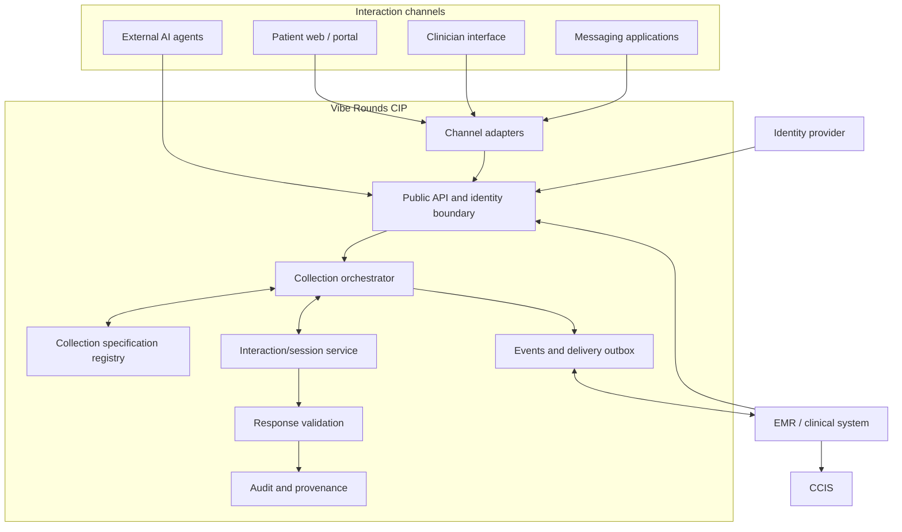

# System architecture

## High-level architecture

## Responsibility boundaries

### EMR / clinical system

The connected EMR remains authoritative for:
- Patient and encounter identity.
- Clinical element definitions and semantic meaning.
- Pathway definitions and clinical requirements.
- Existing observations and clinical record.
- Clinical authorization and record incorporation.
- Clinician review and acceptance policies.

CIP may cache or reference limited metadata for operational performance, but must respect source versions and refresh rules.

### CIP

CIP owns:
- Collection specifications and presentation metadata, subject to EMR element references.
- Collection task lifecycle and assignment workflow.
- Channel-neutral interaction sessions.
- Response capture and structural validation.
- Connector orchestration and delivery state.
- Provenance of the acquisition process.
- Submission handoff and integration audit trail.

CIP does not silently convert a response into a verified EMR observation.

### CCIS

CCIS consumes clinical context through the EMR's established context-export boundary. It should not need to know which channel collected a value. CIP may optionally expose interaction status events for workflow visibility, but it is not the owner of CCIS clinical intelligence execution.

## Logical modules

1. **Context adapter:** imports element references, pathway requirements, and permitted context summaries.
2. **Collection specification registry:** stores reusable collection instructions and response constraints.
3. **Collection planner:** compares pathway requirements with available context and proposes collection needs.
4. **Task service:** creates, assigns, expires, cancels, and tracks tasks.
5. **Interaction service:** manages sessions and turns without binding them to one chat vendor.
6. **Channel adapter interface:** translates platform-specific inbound/outbound payloads.
7. **Response validator:** checks structure, required fields, value constraints, and mapping.
8. **Submission service:** sends a proposed data package to the EMR for its own validation and acceptance.
9. **Audit/provenance service:** records actors, source, timestamps, transformations, and state transitions.
10. **Notification/event service:** handles delivery events, retries, and integration events.

## Deployment evolution

Start as a modular monolith with clear internal interfaces. Do not begin with microservices. Split services only when operational scale, independent deployment, or security boundaries justify it.

Initial deployment can use:
- One application/API process.
- One relational database.
- A background worker for delivery and retries.
- An adapter interface with a mock connector.
- A mock EMR integration for synthetic demonstrations.

## Trust boundaries

Treat every external channel, webhook, AI agent, and integration payload as untrusted input. Authenticate the caller, authorize the requested action, validate payloads, enforce patient scope, and record provenance at the server boundary.
